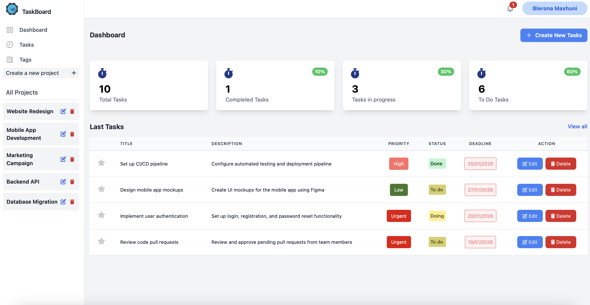
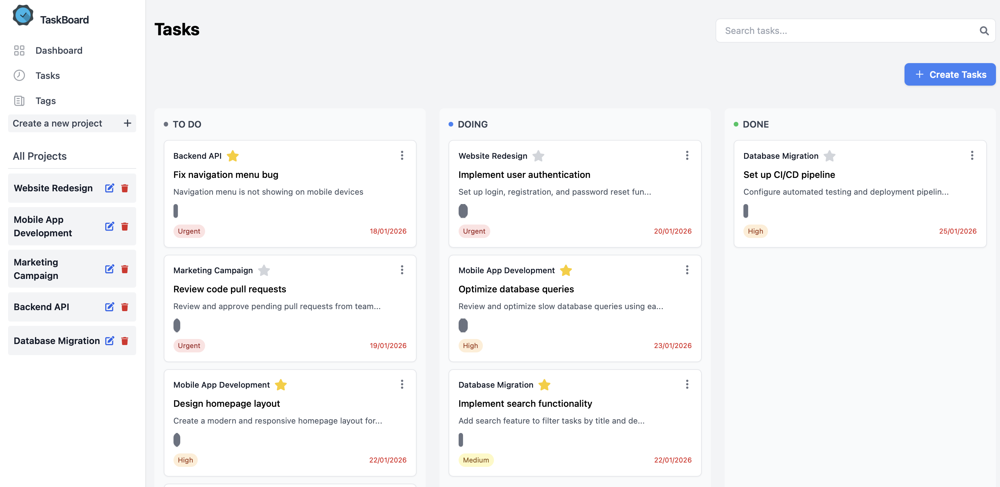
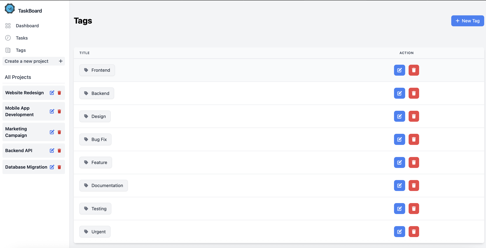
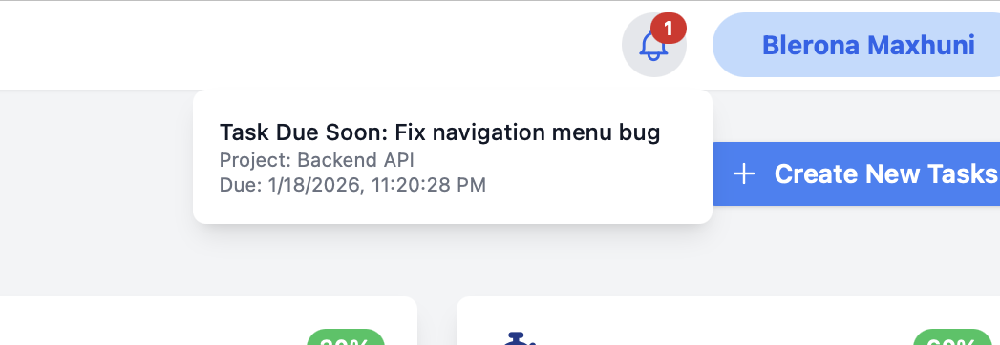

# TaskBoard

A modern, feature-rich task management application built with Laravel. TaskBoard helps you organize your tasks, projects, and tags in an intuitive and efficient way.

## Features

- **Task Management**: Create, edit, and organize tasks with a kanban-style board
- **Priority System**: Set priorities (Urgent, High, Medium, Low) for better task organization
- **Progress Tracking**: Track task progress with status categories (To Do, Doing, Done)
- **Project Organization**: Group tasks under projects for better organization
- **Tag System**: Categorize tasks with custom tags and colors
- **Favorites**: Mark important tasks as favorites for quick access
- **Due Date Tracking**: Set due dates and receive notifications for overdue tasks
- **Search Functionality**: Quickly find tasks using the search feature
- **User Authentication**: Secure user accounts with Laravel Breeze

## Screenshots

### Dashboard


### Tasks View


### Tags Management


### Overdue Task Notifications


## Requirements

- PHP >= 8.0.2
- Composer
- Node.js & NPM
- MySQL/PostgreSQL/SQLite database

## Installation

1. Clone the repository:
```bash
git clone <repository-url>
cd TaskBoard
```

2. Install PHP dependencies:
```bash
composer install
```

3. Install NPM dependencies:
```bash
npm install
```

4. Copy the environment file:
```bash
cp .env.example .env
```

5. Generate application key:
```bash
php artisan key:generate
```

6. Configure your `.env` file with database credentials:
```env
DB_CONNECTION=mysql
DB_HOST=127.0.0.1
DB_PORT=3306
DB_DATABASE=taskboard
DB_USERNAME=your_username
DB_PASSWORD=your_password
```

7. Run migrations:
```bash
php artisan migrate
```

8. Build assets (for development):
```bash
npm run dev
```

Or for production:
```bash
npm run build
```

9. Start the development server:
```bash
php artisan serve
```

10. Visit `http://localhost:8000` in your browser

## Technology Stack

- **Backend**: Laravel 9
- **Frontend**: Blade templates with Tailwind CSS
- **Database**: MySQL/PostgreSQL/SQLite
- **Authentication**: Laravel Breeze
- **Notifications**: Laravel Notifications

## License

The TaskBoard application is open-sourced software licensed under the [MIT license](https://opensource.org/licenses/MIT).
